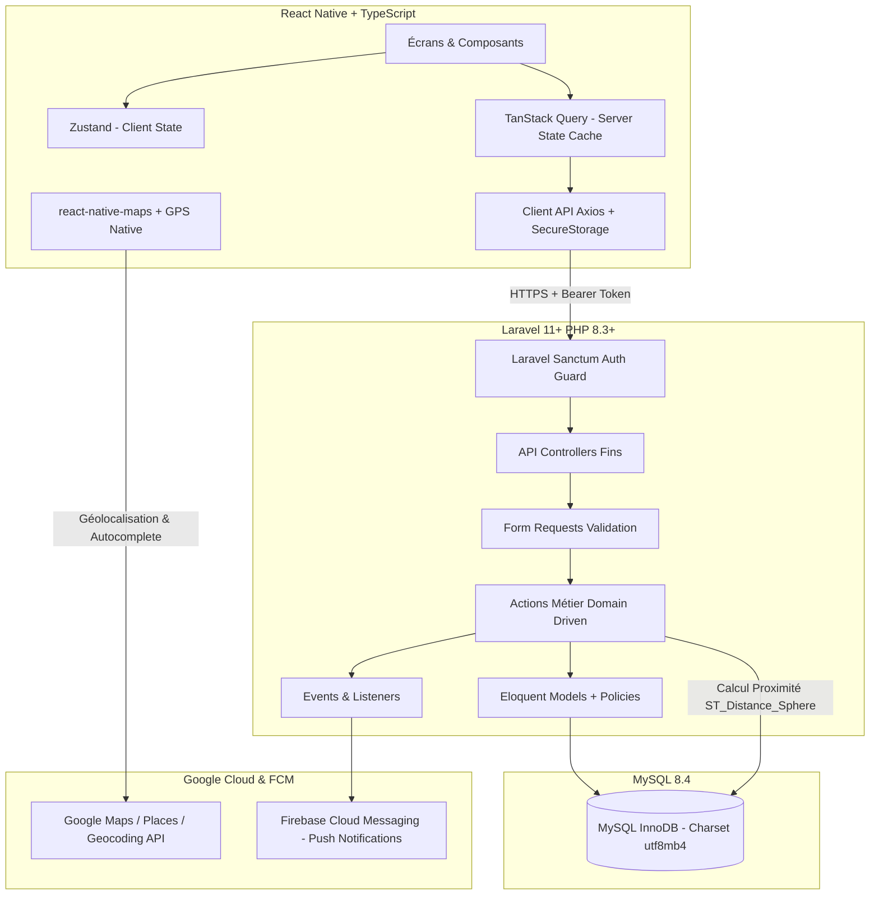

# SportUp — Architecture Technique & System Design

## 1. Vue d'ensemble de l'Architecture System

SportUp est une application mobile full-stack de mise en relation sportive géolocalisée optimisée pour **Madagascar** (`country = MG`).

### Diagramme de Flux de Données



---

## 2. Règles Fondamentales & Contraintes Structurantes

1. **Séparation Stricte Mobile / DB** : Le client mobile ne se connecte **jamais** directement à MySQL. Toutes les opérations transitent obligatoirement par l'API REST Laravel versionnée (`/api/v1/`).
2. **Source de Vérité Backend** : Le backend Laravel est l'unique source de vérité pour la validation métier, le calcul des distances géographiques, le score en direct, la gestion des places et les statistiques.
3. **Contexte Madagascar** :
   - Pays par défaut : `country = MG`
   - Villes de démonstration supportées : Antananarivo, Toamasina, Antsirabe, Fianarantsoa, Mahajanga, Toliara, Antsiranana.
   - Internationalisation (i18n) : Langue initiale en Français (FR), architecture i18n prête pour l'Anglais (EN) et le Malgache (MG).
4. **Resilience & Hors-ligne Terrain** :
   - Le chronomètre et le score d'un match en direct ne dépendent pas uniquement d'un `setInterval()` JS volatil.
   - File d'attente d'événements hors-ligne locale avec mécanisme de synchronisation progressive lors du retour réseau.

---

## 3. Architecture Backend (Laravel)

### Structure des Dossiers

```text
backend/app/
├── Actions/                  # Logique métier pure (Single Responsibility Principle)
│   ├── Auth/
│   ├── Sessions/
│   │   ├── CreateSessionAction.php
│   │   ├── JoinSessionAction.php
│   │   └── LeaveSessionAction.php
│   ├── Matches/
│   │   ├── StartMatchAction.php
│   │   ├── PauseMatchAction.php
│   │   ├── ResumeMatchAction.php
│   │   ├── FinishMatchAction.php
│   │   └── AddMatchEventAction.php
│   ├── Teams/
│   ├── Statistics/
│   │   └── CalculatePlayerStatisticsAction.php
│   └── Tournaments/
├── DTOs/                     # Data Transfer Objects typés
├── Exceptions/               # Exceptions métier personnalisées
├── Http/
│   ├── Controllers/Api/V1/   # Controllers fins dévolus au routage et à la réponse HTTP
│   ├── Requests/Api/V1/      # Validation d'entrées d'API
│   └── Resources/V1/         # Transformateurs JSON (API Resources)
├── Models/                   # Modèles Eloquent & Relations
├── Policies/                 # Autorisations & Sécurité IDOR (Laravel Policies)
├── Services/                 # Services tiers (Google Maps, FCM, Geocoding)
├── Notifications/            # Notifications Push & Mail
├── Events/                   # Événements système
└── Listeners/                # Écouteurs asynchrones
```

### Pattern Actions vs Controllers
Les Controllers restent extrêmement fins (`slim controllers`). Toute la logique métier complexe est encapsulée dans des classes **Actions** uniques à méthode `execute()`, facilitant les tests unitaires et le réemploi.

---

## 4. Architecture Mobile (React Native + TypeScript)

### Structure par Feature Verticale

```text
mobile/src/
├── app/                      # Configuration de l'application & Providers
├── features/                 # Features verticales autonomes
│   ├── auth/                 # Authentification (Login, Register, Reset, Storage)
│   ├── profile/              # Profil joueur & Préférences
│   ├── home/                 # Écran d'accueil & Raccourcis
│   ├── explore/              # Explorer sessions & Carte géolocalisée
│   ├── sessions/             # CRUD Sessions, Rejoindre/Quitter
│   ├── matches/              # Live Match, Chrono, Score & Événements
│   ├── statistics/           # Statistiques individuelles & d'équipe
│   ├── teams/                # Équipes & Membres (V2)
│   ├── tournaments/          # Tournois (V2)
│   ├── notifications/        # Center de notifications (V2)
│   └── chat/                 # Chat de session & d'équipe (V2)
├── components/               # Design System atomique et réutilisable (Button, Card, Input, Badge...)
├── services/                 # Native services (Location, Keychain, Push, Network)
├── hooks/                    # Custom hooks transverses
├── store/                    # Stores globaux Zustand
├── types/                    # Types TypeScript transverses & API
├── utils/                    # Utilitaires (Calcul distance, formatage date)
├── constants/                # App config & Constants
└── theme/                    # Design Tokens (Colors, Typography, Spacing, Radius)
```

---

## 5. Design System Tokens (SportUp UI)

Conformément à la charte visuelle validée :

* **Primary** : `#1456D9` (Bleu Sportif)
* **Primary Dark** : `#0F44B3`
* **Primary Soft** : `#EAF1FE`
* **Navy** : `#0C1C34` (Fond Sombre & Modales)
* **Navy Soft** : `#152847`
* **Background** : `#F6F8FB` (Fond Clair)
* **Surface** : `#FFFFFF`
* **Text** : `#172033`
* **Text Muted** : `#667085`
* **Border** : `#E4E7EC`
* **Success** : `#2BB370` (Vert Terrain)
* **Warning** : `#F28B2E` (Orange Alerte)

**Typographies** :
- **Titres / Headings** : `Poppins` (Bold / SemiBold)
- **Contenu / Body** : `Inter` (Regular / Medium / SemiBold)
- **Icônes** : `Lucide Icons` (Vector Icons sans emojis UI).
