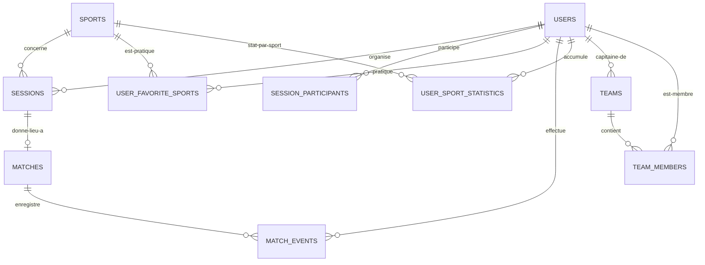

# SportUp — Conception de la Base de Données (MySQL 8.4)

## 1. Vue d'Ensemble & Règles de Modélisation

* **Moteur SQL** : `InnoDB` (Support complet des transactions et des contraintes d'intégrité référentielle par clés étrangères).
* **Jeu de caractères** : `utf8mb4_unicode_ci` (Prise en charge des emojis dans les descriptions et caractères accentués).
* **Statuts** : Enums natifs SQL pour les listes fermées (`sessions.status`, `matches.status`).
* **Géolocalisation** : `DECIMAL(10,7)` pour latitude et longitude (précision ~1 cm, idéal pour la géolocalisation de terrains).
* **Optimisation des performances** :
  - Colonne dénormalisée `current_participants` dans `sessions` pour éviter les `COUNT(*)` sur les requêtes paginées.
  - Table d'agrégats `user_sport_statistics` mise à jour à la clôture de chaque match pour garantir un affichage instantané du profil sans calcul à la volée.

---

## 2. Diagramme Conceptuel (MCD) & Relations



---

## 3. Modèle Logique de Données (MLD)

1. `users` (**id**, username, email, password, photo_path, city, level, created_at, updated_at, deleted_at)
2. `sports` (**id**, name, slug, icon, color_hex, is_active, created_at, updated_at)
3. `user_favorite_sports` (**user_id**, **sport_id**)
4. `sessions` (**id**, organizer_id, sport_id, type, format, session_date, start_time, latitude, longitude, address, city, region, country, level, max_participants, current_participants, description, status, cancelled_reason, created_at, updated_at)
5. `session_participants` (**session_id**, **user_id**, joined_at)
6. `teams` (**id**, name, sport_id, captain_id, logo_path, created_at, updated_at)
7. `team_members` (**team_id**, **user_id**, role, joined_at)
8. `matches` (**id**, session_id, tournament_id, stage, round_number, team_a_id, team_b_id, status, score_team_a, score_team_b, team_a_fouls, team_b_fouls, team_a_timeouts, team_b_timeouts, team_a_color, team_b_color, team_a_logo, team_b_logo, current_period, total_periods, period_duration_seconds, elapsed_seconds, period_elapsed_seconds, period_started_at, last_resumed_at, started_at, paused_at, finished_at, created_at, updated_at)
9. `match_events` (**id**, match_id, type, team_side, player_id, sub_in_player_id, sub_out_player_id, related_player_id, points, shot_type, shot_result, rebound_type, foul_type, period, minute, match_time_seconds, recorded_by, is_cancelled, cancelled_at, idempotency_key, metadata, created_at)
10. `match_players` (**id**, match_id, user_id, team_side, jersey_number, position, is_starter, is_on_court, seconds_played, last_subbed_in_at, created_at, updated_at)
11. `user_sport_statistics` (**user_id**, **sport_id**, matches_played, wins, losses, draws, goals_scored, points_scored, assists, rebounds, blocks, steals, mvp_count, updated_at)
12. `user_statistics_history` (**id**, user_id, sport_id, match_id, stats_json, played_at, created_at, updated_at)
13. `tournaments` (**id**, name, sport_id, organizer_id, start_date, end_date, max_teams, status, created_at, updated_at)
14. `tournament_teams` (**tournament_id**, **team_id**, joined_at)
15. `notifications` (**id**, user_id, type, title, body, is_read, related_session_id, related_match_id, created_at)

---

## 4. DDL MySQL (Migrations Eloquent Ready)

```sql
-- 1. USERS & AUTHENTIFICATION
CREATE TABLE users (
    id BIGINT UNSIGNED AUTO_INCREMENT PRIMARY KEY,
    username VARCHAR(50) NOT NULL UNIQUE,
    email VARCHAR(255) NOT NULL UNIQUE,
    email_verified_at TIMESTAMP NULL,
    password VARCHAR(255) NOT NULL,
    photo_path VARCHAR(255) NULL,
    city VARCHAR(100) NULL,
    level ENUM('beginner','intermediate','advanced') NULL,
    remember_token VARCHAR(100) NULL,
    created_at TIMESTAMP NULL,
    updated_at TIMESTAMP NULL,
    deleted_at TIMESTAMP NULL,
    INDEX idx_users_city (city)
) ENGINE=InnoDB DEFAULT CHARSET=utf8mb4 COLLATE=utf8mb4_unicode_ci;

CREATE TABLE personal_access_tokens (
    id BIGINT UNSIGNED AUTO_INCREMENT PRIMARY KEY,
    tokenable_type VARCHAR(255) NOT NULL,
    tokenable_id BIGINT UNSIGNED NOT NULL,
    name VARCHAR(255) NOT NULL,
    token VARCHAR(64) NOT NULL UNIQUE,
    abilities TEXT NULL,
    last_used_at TIMESTAMP NULL,
    expires_at TIMESTAMP NULL,
    created_at TIMESTAMP NULL,
    updated_at TIMESTAMP NULL,
    INDEX idx_tokenable (tokenable_type, tokenable_id)
) ENGINE=InnoDB DEFAULT CHARSET=utf8mb4 COLLATE=utf8mb4_unicode_ci;

-- 2. SPORTS & PREFERENCES
CREATE TABLE sports (
    id BIGINT UNSIGNED AUTO_INCREMENT PRIMARY KEY,
    name VARCHAR(50) NOT NULL,
    slug VARCHAR(50) NOT NULL UNIQUE,
    icon VARCHAR(50) NULL,
    color_hex CHAR(7) NULL,
    is_active BOOLEAN NOT NULL DEFAULT TRUE,
    created_at TIMESTAMP NULL,
    updated_at TIMESTAMP NULL
) ENGINE=InnoDB DEFAULT CHARSET=utf8mb4 COLLATE=utf8mb4_unicode_ci;

CREATE TABLE user_favorite_sports (
    user_id BIGINT UNSIGNED NOT NULL,
    sport_id BIGINT UNSIGNED NOT NULL,
    PRIMARY KEY (user_id, sport_id),
    FOREIGN KEY (user_id) REFERENCES users(id) ON DELETE CASCADE,
    FOREIGN KEY (sport_id) REFERENCES sports(id) ON DELETE CASCADE
) ENGINE=InnoDB DEFAULT CHARSET=utf8mb4 COLLATE=utf8mb4_unicode_ci;

-- 3. SESSIONS & PARTICIPATIONS
CREATE TABLE sessions (
    id BIGINT UNSIGNED AUTO_INCREMENT PRIMARY KEY,
    organizer_id BIGINT UNSIGNED NOT NULL,
    sport_id BIGINT UNSIGNED NOT NULL,
    type ENUM('find_players','find_opponent','free_match') NOT NULL,
    format VARCHAR(20) NOT NULL,
    session_date DATE NOT NULL,
    start_time TIME NOT NULL,
    latitude DECIMAL(10,7) NOT NULL,
    longitude DECIMAL(10,7) NOT NULL,
    address VARCHAR(255) NULL,
    city VARCHAR(100) NULL,
    region VARCHAR(100) NULL,
    country CHAR(2) NOT NULL DEFAULT 'MG',
    level ENUM('beginner','intermediate','advanced','all') NOT NULL DEFAULT 'all',
    max_participants SMALLINT UNSIGNED NOT NULL,
    current_participants SMALLINT UNSIGNED NOT NULL DEFAULT 1,
    description TEXT NULL,
    status ENUM('open','full','cancelled','in_progress','finished') NOT NULL DEFAULT 'open',
    cancelled_reason VARCHAR(255) NULL,
    created_at TIMESTAMP NULL,
    updated_at TIMESTAMP NULL,
    FOREIGN KEY (organizer_id) REFERENCES users(id) ON DELETE CASCADE,
    FOREIGN KEY (sport_id) REFERENCES sports(id) ON DELETE RESTRICT,
    INDEX idx_sessions_status_date (status, session_date),
    INDEX idx_sessions_geo (latitude, longitude)
) ENGINE=InnoDB DEFAULT CHARSET=utf8mb4 COLLATE=utf8mb4_unicode_ci;

CREATE TABLE session_participants (
    session_id BIGINT UNSIGNED NOT NULL,
    user_id BIGINT UNSIGNED NOT NULL,
    joined_at TIMESTAMP NOT NULL DEFAULT CURRENT_TIMESTAMP,
    PRIMARY KEY (session_id, user_id),
    FOREIGN KEY (session_id) REFERENCES sessions(id) ON DELETE CASCADE,
    FOREIGN KEY (user_id) REFERENCES users(id) ON DELETE CASCADE
) ENGINE=InnoDB DEFAULT CHARSET=utf8mb4 COLLATE=utf8mb4_unicode_ci;

-- 4. MATCHES & EVENEMENTS
CREATE TABLE matches (
    id BIGINT UNSIGNED AUTO_INCREMENT PRIMARY KEY,
    session_id BIGINT UNSIGNED NOT NULL UNIQUE,
    status ENUM('pending','in_progress','paused','finished') NOT NULL DEFAULT 'pending',
    score_team_a SMALLINT UNSIGNED NOT NULL DEFAULT 0,
    score_team_b SMALLINT UNSIGNED NOT NULL DEFAULT 0,
    current_period TINYINT UNSIGNED NOT NULL DEFAULT 1,
    total_periods TINYINT UNSIGNED NOT NULL DEFAULT 2,
    period_duration_seconds INT UNSIGNED NOT NULL,
    elapsed_seconds INT UNSIGNED NOT NULL DEFAULT 0,
    started_at TIMESTAMP NULL,
    paused_at TIMESTAMP NULL,
    finished_at TIMESTAMP NULL,
    created_at TIMESTAMP NULL,
    updated_at TIMESTAMP NULL,
    FOREIGN KEY (session_id) REFERENCES sessions(id) ON DELETE CASCADE
) ENGINE=InnoDB DEFAULT CHARSET=utf8mb4 COLLATE=utf8mb4_unicode_ci;

CREATE TABLE match_events (
    id BIGINT UNSIGNED AUTO_INCREMENT PRIMARY KEY,
    match_id BIGINT UNSIGNED NOT NULL,
    type ENUM('goal','basket','foul','card_yellow','card_red','substitution') NOT NULL,
    team_side ENUM('team_a','team_b') NOT NULL,
    player_id BIGINT UNSIGNED NULL,
    points TINYINT UNSIGNED NULL,
    minute SMALLINT UNSIGNED NOT NULL,
    created_at TIMESTAMP NULL,
    FOREIGN KEY (match_id) REFERENCES matches(id) ON DELETE CASCADE,
    FOREIGN KEY (player_id) REFERENCES users(id) ON DELETE SET NULL,
    INDEX idx_match_events_match (match_id)
) ENGINE=InnoDB DEFAULT CHARSET=utf8mb4 COLLATE=utf8mb4_unicode_ci;

-- 5. STATISTIQUES AGREGÉES
CREATE TABLE user_sport_statistics (
    user_id BIGINT UNSIGNED NOT NULL,
    sport_id BIGINT UNSIGNED NOT NULL,
    matches_played INT UNSIGNED NOT NULL DEFAULT 0,
    wins INT UNSIGNED NOT NULL DEFAULT 0,
    losses INT UNSIGNED NOT NULL DEFAULT 0,
    draws INT UNSIGNED NOT NULL DEFAULT 0,
    goals_scored INT UNSIGNED NOT NULL DEFAULT 0,
    points_scored INT UNSIGNED NOT NULL DEFAULT 0,
    mvp_count INT UNSIGNED NOT NULL DEFAULT 0,
    updated_at TIMESTAMP NULL,
    PRIMARY KEY (user_id, sport_id),
    FOREIGN KEY (user_id) REFERENCES users(id) ON DELETE CASCADE,
    FOREIGN KEY (sport_id) REFERENCES sports(id) ON DELETE CASCADE
) ENGINE=InnoDB DEFAULT CHARSET=utf8mb4 COLLATE=utf8mb4_unicode_ci;

-- 6. EQUIPES (V2 READY)
CREATE TABLE teams (
    id BIGINT UNSIGNED AUTO_INCREMENT PRIMARY KEY,
    name VARCHAR(100) NOT NULL,
    sport_id BIGINT UNSIGNED NOT NULL,
    captain_id BIGINT UNSIGNED NOT NULL,
    logo_path VARCHAR(255) NULL,
    created_at TIMESTAMP NULL,
    updated_at TIMESTAMP NULL,
    FOREIGN KEY (sport_id) REFERENCES sports(id) ON DELETE RESTRICT,
    FOREIGN KEY (captain_id) REFERENCES users(id) ON DELETE RESTRICT
) ENGINE=InnoDB DEFAULT CHARSET=utf8mb4 COLLATE=utf8mb4_unicode_ci;

CREATE TABLE team_members (
    team_id BIGINT UNSIGNED NOT NULL,
    user_id BIGINT UNSIGNED NOT NULL,
    role ENUM('captain','member') NOT NULL DEFAULT 'member',
    joined_at TIMESTAMP NOT NULL DEFAULT CURRENT_TIMESTAMP,
    PRIMARY KEY (team_id, user_id),
    FOREIGN KEY (team_id) REFERENCES teams(id) ON DELETE CASCADE,
    FOREIGN KEY (user_id) REFERENCES users(id) ON DELETE CASCADE
) ENGINE=InnoDB DEFAULT CHARSET=utf8mb4 COLLATE=utf8mb4_unicode_ci;

-- 7. NOTIFICATIONS
CREATE TABLE notifications (
    id BIGINT UNSIGNED AUTO_INCREMENT PRIMARY KEY,
    user_id BIGINT UNSIGNED NOT NULL,
    type VARCHAR(50) NOT NULL,
    title VARCHAR(150) NOT NULL,
    body VARCHAR(500) NOT NULL,
    is_read BOOLEAN NOT NULL DEFAULT FALSE,
    related_session_id BIGINT UNSIGNED NULL,
    related_match_id BIGINT UNSIGNED NULL,
    created_at TIMESTAMP NULL,
    FOREIGN KEY (user_id) REFERENCES users(id) ON DELETE CASCADE,
    FOREIGN KEY (related_session_id) REFERENCES sessions(id) ON DELETE SET NULL,
    FOREIGN KEY (related_match_id) REFERENCES matches(id) ON DELETE SET NULL,
    INDEX idx_notifications_user_read (user_id, is_read)
) ENGINE=InnoDB DEFAULT CHARSET=utf8mb4 COLLATE=utf8mb4_unicode_ci;
```
