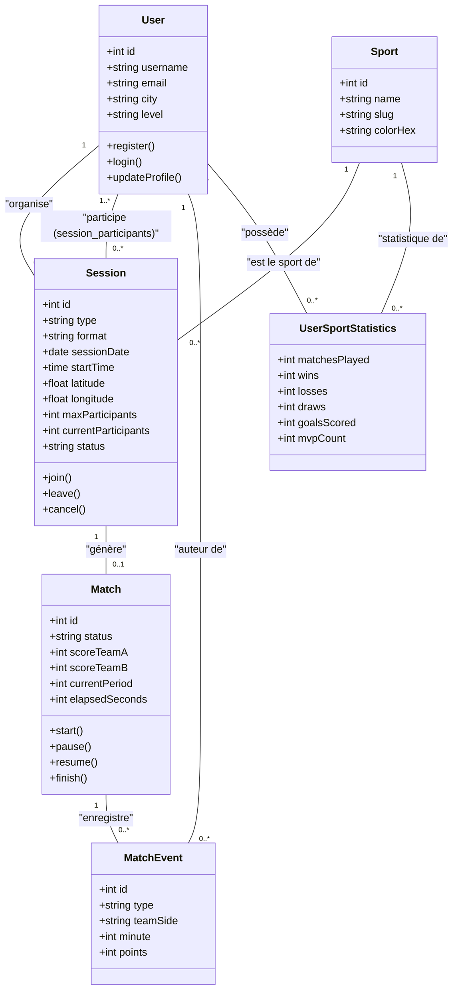
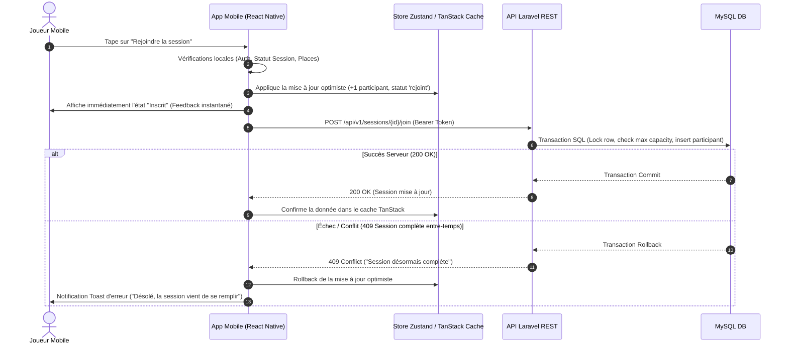
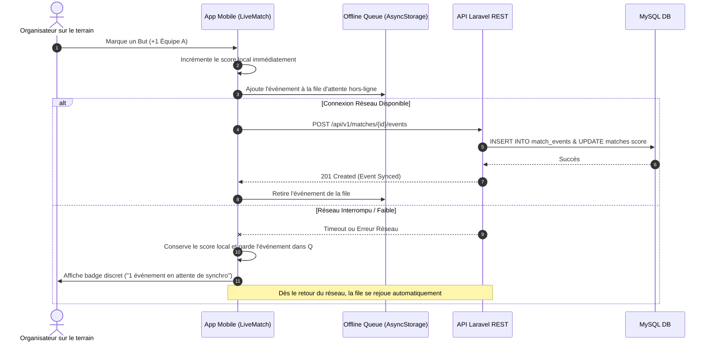
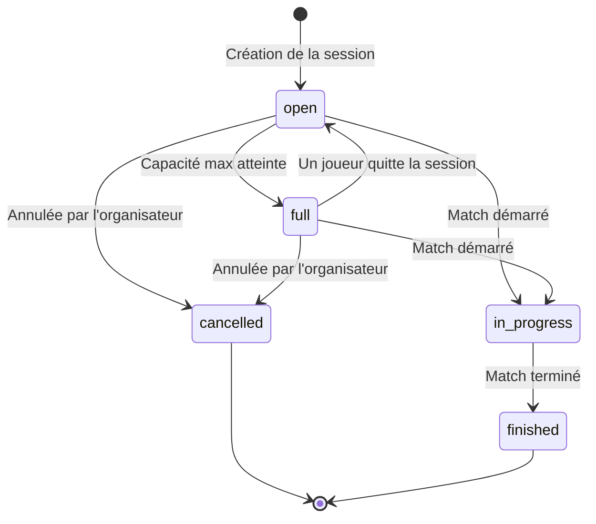
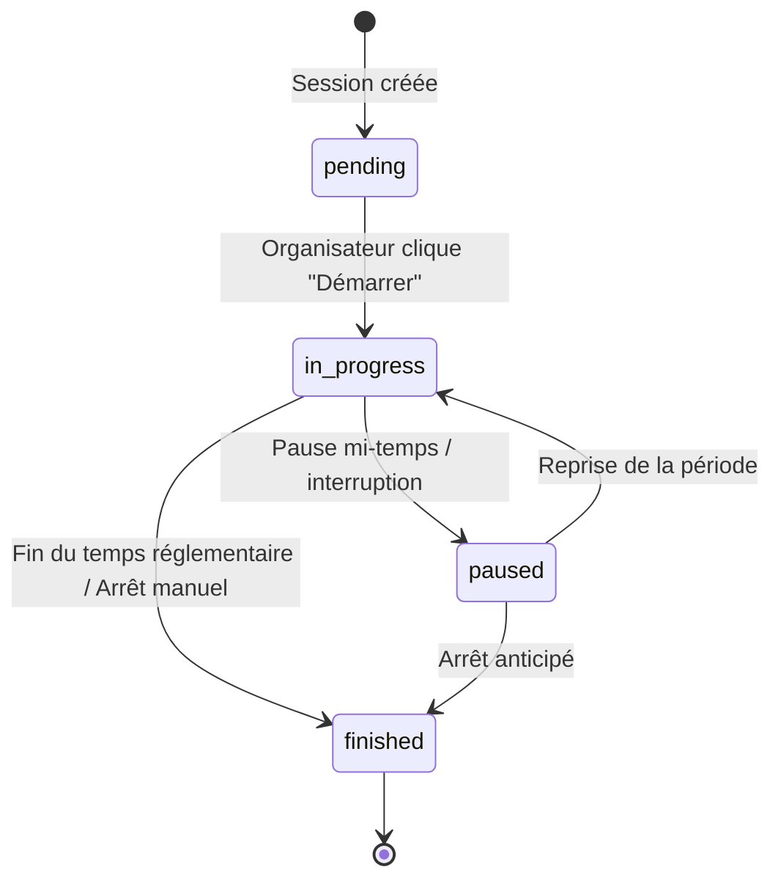
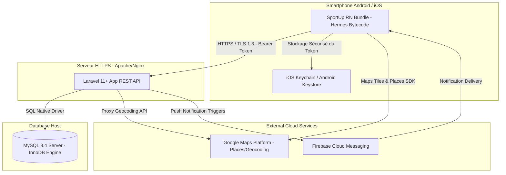

# SportUp — Modélisation & Diagrammes UML

## 1. Diagramme de Cas d'Utilisation (Use Case Diagram)

```mermaid
graph TD
    Visiteur((Visiteur))
    Joueur((Joueur Authentifié))
    Organisateur((Organisateur))
    Capitaine((Capitaine d'équipe))

    subgraph SportUp Mobile System
        UC_Auth[S'inscrire / Se connecter]
        UC_Profile[Consulter & Modifier Profil]
        UC_Search[Rechercher Session Géolocalisée]
        UC_Join[Rejoindre une Session]
        UC_Leave[Quitter une Session]
        UC_CreateSession[Créer une Session Sportive]
        UC_EditSession[Modifier / Annuler sa Session]
        UC_StartMatch[Démarrer un Match]
        UC_EventMatch[Enregistrer Buts / Paniers / Événements]
        UC_FinishMatch[Clôturer un Match & Valider Score]
        UC_Stats[Consulter ses Statistiques]
        UC_Team[Gérer son Équipe - V2]
    end

    Visiteur --> UC_Auth
    Joueur --> UC_Profile
    Joueur --> UC_Search
    Joueur --> UC_Join
    Joueur --> UC_Leave
    Joueur --> UC_Stats

    Joueur <|-- Organisateur
    Organisateur --> UC_CreateSession
    Organisateur --> UC_EditSession
    Organisateur --> UC_StartMatch
    Organisateur --> UC_EventMatch
    Organisateur --> UC_FinishMatch

    Joueur <|-- Capitaine
    Capitaine --> UC_Team
```

---

## 2. Diagramme de Classes (Class Diagram)



---

## 3. Diagramme de Séquence : Rejoindre une Session (Mise à jour Optimiste)



---

## 4. Diagramme de Séquence : Match en Direct & Événement Hors-ligne



---

## 5. Diagrammes d'État-Transition

### Statut d'une Session



### Statut d'un Match



---

## 6. Diagramme de Déploiement (Deployment Diagram)


